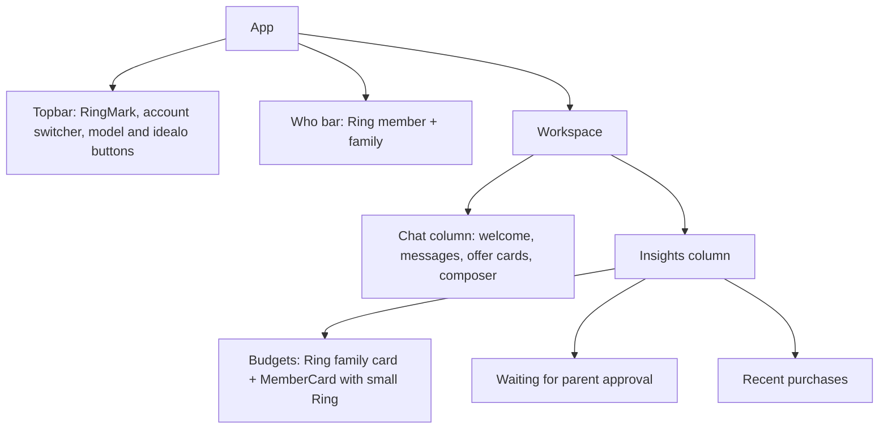

<!--
Author:    rhaveen-sa (with Claude Code)
Version:   0.1.0
Filename:  app_ui_rings.md
Pathname:  doc/design/app_ui_rings.md
Purpose:   UI brief for restyling the web app (web/shopper-app.jsx, web/styles.css) in the "Rings" design of the pitch deck and website.
-->
# App UI: "Rings"

Same system as [`website_design.md`](website_design.md): system font, light grey page, white cards, big tabular numbers,
one spending ring per family member. Dark mode follows the system and uses the same colours on a black page.

## What changes
| Area | Before | After |
|---|---|---|
| Logo | blue square with a spark | three small rings (teen, child, family) |
| Role colours | purple, teal, amber | teen blue, child green, parent orange (the family ring) |
| Account switcher | letter avatars | same, in the ring colours; frosted top bar |
| "Signed in as" bar | coloured left border, two numbers | a ring for the member (outer) and the family (inner) with the amount left in the centre |
| Budgets panel | progress bars | family card with all three rings; member cards with one small ring each |
| Buttons and chips | 8 px corners | pill shape; blue for actions, red only for a refusal |
| Offer cards | dashed border | white card; the cheapest offer gets a green outline and tag |

No logic changes. All numbers still come from the wallet through `/api/state`.

## Components

`Ring` (new, in `web/shopper-app.jsx`): props `arcs` (list of `{ pct, tone }`, outer first), `size`, `stroke`, `center`, `label`.
SVG only, round caps, 13 % opacity track, gradient arc, end dot with a soft shadow, minimum visible arc of 3 %,
fills on mount over 1.2 s, no animation with `prefers-reduced-motion`. It has `role="img"` and an `aria-label` with the numbers.
