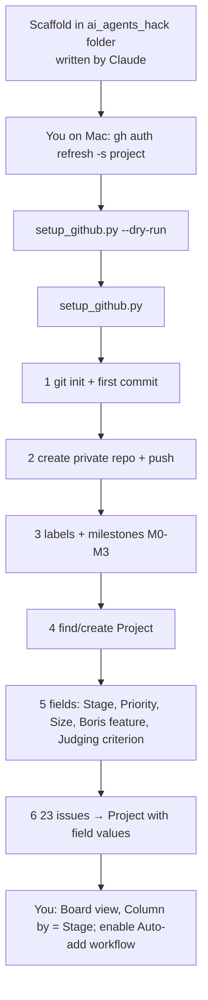
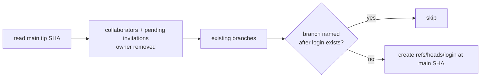

<!--
Author:    mikomeller
Version:   0.1.2
Filename:  todo.md
Pathname:  doc/tasks/todo.md
Purpose:   Plan and progress tracker for 12_family_shopper_agent (setup first, then the build backlog lives in the GitHub Project)
-->
# Plan — 12_family_shopper_agent

## Task 1 — Repo, GitHub Project and backlog (2026-11-27)

- [x] Research: Affinidi, TrustBoris brief, idealo MCP → `doc/research/affinidi_boris_idealo.md`
- [x] Diagrams: architecture + purchase sequence → `doc/diagrams/`
- [x] Scaffold: README, CLAUDE.md, .gitignore, issue forms, `config/family_budget.example.yaml`
- [x] Backlog: 10 labels, 4 milestones, 5 fields, 23 issues → `scripts/backlog.json`
- [x] Setup script `scripts/setup_github.py` (idempotent, `--dry-run`, `--project-number`)
- [x] Verified offline: script compiles; dry-run prints full plan (23 issue creates, 115 field edits); invalid label/field values are rejected; all YAML parses
- [x] Scaffold copied to the working folder `~/Documents/M1_20230921/src/genAI/12_family_shopper_agent` (17 files, checksums identical; Drive copy left untouched)
- [ ] **You:** run `python3 scripts/setup_github.py` on your Mac from that folder
- [ ] **You:** Board view (Column by = Stage) + Auto-add workflow
- [ ] Verify on GitHub: repo private, 23 issues in the Project, fields set, issue forms offered under "New issue"

## Task 2 — One branch per collaborator, main reserved for code (2026-11-27)

- [x] Script `scripts/create_collaborator_branches.py` (re-runnable, `--dry-run`)
- [x] Verified against a stubbed `gh`: owner skipped, existing branch skipped, pending invitee included, e-mail invite reported, zero writes to `main`
- [ ] **You:** after `setup_github.py` and inviting collaborators, run it on your Mac
- [ ] Verify on GitHub: one branch per collaborator, `main` unchanged
- [ ] Optional: protect `main` (require pull requests) — on a private personal repo this needs GitHub Pro

## Open decisions
- Does a parent-approved child order still count against the child's personal cap? Proposal: yes.
- Does Boris forward the verified caller identity to MCP tools? → spike issue (P0, M0).

## Results
- 2026-11-27: scaffold and script delivered and verified offline; live GitHub run pending (needs mikomeller's gh login).
- 2026-11-27: collaborator-branch script delivered and verified with a stubbed gh; live run pending.
