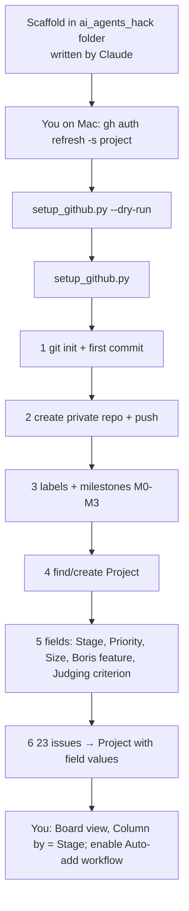
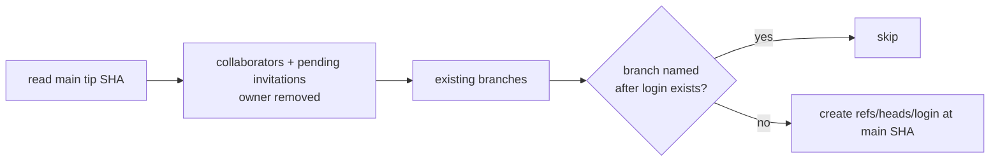

<!--
Author:    mikomeller
Version:   0.1.8
Filename:  todo.md
Pathname:  doc/tasks/todo.md
Purpose:   Plan and progress tracker for 12_family_shopper_agent (setup first, then the build backlog lives in the GitHub Project)
-->
# Plan — 12_family_shopper_agent

## Task 1 — Repo, GitHub Project and backlog (2026-11-27)

- [x] Research: Affinidi, TrustBoris brief, idealo MCP → `doc/research/affinidi_boris_idealo.md`
- [x] Diagrams: architecture + purchase sequence → `doc/diagrams/`
- [x] Scaffold: README, CLAUDE.md, .gitignore, issue forms, `config/family_budget.example.yaml`
- [x] Backlog: 10 labels, 4 milestones, 5 fields, 23 issues → `scripts/backlog.json`
- [x] Setup script `scripts/setup_github.py` (idempotent, `--dry-run`, `--project-number`)
- [x] Verified offline: script compiles; dry-run prints full plan (23 issue creates, 115 field edits); invalid label/field values are rejected; all YAML parses
- [x] Scaffold copied to the working folder `~/Documents/M1_20230921/src/genAI/12_family_shopper_agent` (17 files, checksums identical; Drive copy left untouched)
- [x] First live run failed at step 2 ("Unable to add remote origin"); fixed `ensure_repo` (v0.1.1): create repo without gh's remote handling, add origin only if missing, push when no upstream
- [x] Verified with real git against a local bare remote: push happens with existing origin; re-run skips the push
- [ ] **You:** re-run `python3 scripts/setup_github.py` on your Mac from that folder, then commit the script fix
- [ ] **You:** Board view (Column by = Stage) + Auto-add workflow
- [ ] Verify on GitHub: repo private, 23 issues in the Project, fields set, issue forms offered under "New issue"

## Task 2 — One branch per collaborator, main reserved for code (2026-11-27)

- [x] Script `scripts/create_collaborator_branches.py` (re-runnable, `--dry-run`)
- [x] Verified against a stubbed `gh`: owner skipped, existing branch skipped, pending invitee included, e-mail invite reported, zero writes to `main`
- [ ] **You:** after `setup_github.py` and inviting collaborators, run it on your Mac
- [ ] Verify on GitHub: one branch per collaborator, `main` unchanged
- [ ] Optional: protect `main` (require pull requests) — on a private personal repo this needs GitHub Pro

## Task 3 — Kanban hierarchy, orchestration, evals and handover (2026-11-27)

Diagram: [`doc/diagrams/orchestration.mmd`](../diagrams/orchestration.mmd)

- [x] Plan and recommendations presented; owner's go received (restructuring OK; orchestration runs in Claude Code)
- [x] Checked the docs: Claude Code subagent file format and `--agent`; GitHub sub-issues REST API
- [x] `scripts/backlog.json` v0.1.2: 7 epics, 10 new stories, 3 labels, `parent` on 30 stories (40 issues)
- [x] `scripts/setup_github.py` v0.1.2: step 7 links stories to epics; field values only on newly created issues
- [x] Verified with a stubbed `gh`: first run creates 17, reuses 23, links 30, 85 field edits (new issues only);
      re-run creates 0, links 0, 0 field edits; refused sub-issue API gives 30 warnings and the run still finishes
- [x] `scripts/board.py` v0.1.0 (list / move); verified against a stub: list, move, unknown stage, issue not on board
- [x] `doc/agents/` (source, to be copied to `.claude/agents/`; the desktop app may not write into `.claude`): orchestrator (system prompt), architect + reviewer (Opus), wallet-dev + test-eval + docs-demo (Sonnet)
- [x] `doc/evals/eval_plan.md` (L0–L4, 13 + 9 + 10 cases, scenario format)
- [x] `doc/handover/HANDOVER.md`, `doc/tasks/pending.md`
- [ ] **You:** run `python3 scripts/setup_github.py` on your Mac; check the epic links and `board.py list` against the real board
- [ ] **You:** `mkdir -p .claude/agents && cp doc/agents/*.md .claude/agents/`, then `claude --agent orchestrator` — confirm it starts and lists the five subagents
- [ ] **You:** decide A1 and A2 in `doc/evals/eval_plan.md`

## Task 4 — Hackathon build (2026-11-27)

- [x] Wallet design `doc/design/wallet_mcp.md` + `doc/diagrams/wallet_contract.mmd` (#6) — on `main`
- [x] Wallet server `src/family_shopper/wallet/`, 7 tools (#7, #34) — on `main`
- [x] Seed script `scripts/seed_wallet.py` (#35) — on `main`; guard against wiping the db still open (Orch)
- [x] Cap and contract tests L1-01…L1-13, L2-01…L2-09 (#8) — 72 tests, `evals/results/2026-11-27_l1_l2.md`
- [x] idealo mock with fixtures incl. one prompt injection (#36) — real idealo response shapes unverified
- [x] Offline demo `scripts/demo.py` + `doc/demo/demo_script.md` (#17, #18, #19) — ends `DEMO OK: 5/5 scenes`
- [x] Boris system prompt and runbook (#9, #11, #12) — every Boris dashboard step unverified
- [x] Boris CLI 0.1.35 in `docker/boris/Dockerfile` + `doc/runbooks/boris_docker.md` — `boris doctor`: "Not signed in"
- [x] Discount check (ticket #25, Epic E7): `doc/design/discount_check.md`, `src/family_shopper/discount_check.py`, tool `check_discount`, DC-01…DC-19 pass
- [x] CI `.github/workflows/ci.yml` with automerge — verified live on PR #44 and PR #49
- [x] Board: 7 epics, 10 stories, 30 links via `scripts/setup_github.py`; later E7 (#45) and #46, #47, #48; `backlog.json` v0.1.3 (44 issues)
- [x] Independent review: approve, no blocking findings
- [x] Owner decisions A1 and A2 confirmed
- [x] **Orch:** web UI (collaborator PR #33) wired to the wallet: purchases, budgets and approvals go through the Family Wallet (`src/wallet-client.js`); `node scripts/ui_wallet_smoke.mjs` passes 7 of 7
- [ ] **You / Orch:** web UI open points: chat endpoint untested (no OpenAI key), UI not viewed in a browser, `src/cli.js` (`npm start`) still uses its own float budget file and bypasses the wallet
- [ ] **You:** Boris login in the container (`--device`) and create the agent in Agent Builder per `doc/runbooks/boris_agent_setup.md`
- [ ] **You:** identity spike #4
- [ ] **Orch:** eval harness and L3 incl. S-11
- [ ] **You:** idealo live smoke test #3
- [ ] **Orch:** reviewer remarks (seed guard, `personal_cap: null` for teen/child, `deep_link` scheme, `list_orders("2026-13")`, int() coercion in mock)
- [ ] **Orch:** ADR 0001, Docker Compose (if time)

## Task 5 — Round two (2026-11-27 evening)
- [x] Wallet tool `reject_request` (#51); 8 tools; migration of old databases in `init_db`
- [x] Owner decisions: a parent can reject; INFLATED blocks (#52), enforced in the web UI purchase path and prompt rule 8
- [x] Web UI family accounts (demo sign-in), offline chat mode (#53); `node scripts/ui_wallet_smoke.mjs` 17 of 17, also via Docker
- [x] Full application in Docker, `docker compose up -d --build app` on `http://localhost:6274` (#54); runbook `doc/runbooks/docker_app.md`
- [x] Eval harness, scenarios S-01…S-13, L3/L4 at the tool layer (#37, #38, #39); `evals/results/2026-11-27_l3_l4.md`
- [x] Board: stories #51-#55 created from `backlog.json` v0.1.4 (49 issues) and linked; ticket #25 assessed and linked under Epic #45
- [x] Checked: `rodrigo-agent` / PR #33 contain no Boris details, MCP credentials or OpenAI key
- [x] Merged to `main` via PR #56 (merge commit fe056fb); gates: 144 passed, 13 skipped, ruff clean, `DEMO OK: 5/5 scenes`
- [x] Docs: prompt, orchestrator, README, handover, pending, lessons, demo script updated
- [ ] Independent review of PR #56 (pending) and fixes
- [ ] Owner: OpenAI key, idealo sign-in, Boris connection details (#55); `boris login`; agent in Agent Builder
- [ ] Spike #4; LLM driver in `evals/drivers.py`; L3 for real; L4 against Boris
- [ ] Browser click-through of the UI (nobody has done it); chat with a real OpenAI key; live idealo OAuth
- [ ] `src/cli.js` rewired to the wallet or removed

## Task 6 — Round three (2026-11-27 late evening)
- [x] Independent review of PR #56: changes required (B1 discount check failed open, B2 client named the price)
- [x] B1 and B2 fixed in PR #59 and re-attacked by the reviewer: approve, nothing blocking; merged by auto-merge, CI green (a31a110)
- [x] Owner's bug fixed: offers are budget-aware (wallet `check_budget(price_cents)` → `fits`; LLM path `enforceBudget`); `node scripts/offline_agent_budget_check.mjs` 6 of 6
- [x] `/api/state` and chat context read as the signed-in member
- [x] Bring your own model provider (#58): `src/llm-provider.js`, "Model provider" dialog; `FAKE_LLM=1 node scripts/ui_wallet_smoke.mjs` 43 of 43 against `scripts/fake_llm.mjs`
- [x] Web UI redesign, `?as=` / `?q=` demo links; headless screenshots at 1280px seen
- [x] idealo mock: 13 products; `compose.yaml` publishes `127.0.0.1:6274` only; container rebuilt, offline smoke 32 of 32
- [x] Docs: prompt, orchestrator, README, handover, pending, todo, lessons, eval plan (S-14), demo script updated
- [ ] Owner: OpenAI or Nebius key, idealo sign-in, Boris connection details (#55); `boris login`; agent in Agent Builder; spike #4
- [ ] Not tested: real OpenAI / Nebius key, live idealo OAuth, `ALLOW_UNVERIFIED_LIVE_PURCHASES` path, LLM-mode identity under a real model
- [ ] Browser click-through of the UI (purchase status cards, approve/reject, light theme, 390px phone, provider dialog, keyboard focus)
- [ ] LLM driver for L3; S-14 in the eval harness; live idealo verification so live purchases can be enabled
- [ ] Open reviewer remarks; `src/cli.js` rewired or removed

## Open decisions
- Does a parent-approved child order still count against the child's personal cap? Decided by the owner 2026-11-27: yes (A1).
- Open: source of `sale_days` for the discount check. Decided 2026-11-27: a parent can reject a request; INFLATED blocks the order.
- Does Boris forward the verified caller identity to MCP tools? → spike issue (P0, M0).

## Results
- 2026-11-27: scaffold and script delivered and verified offline; live GitHub run pending (needs mikomeller's gh login).
- 2026-11-27: collaborator-branch script delivered and verified with a stubbed gh; live run pending.
- 2026-11-27: Kanban hierarchy, orchestrator + subagents, eval plan, handover and pending list delivered; verified offline and against a stubbed gh. Live GitHub run and first Claude Code session pending. No product code yet.
- 2026-11-27: hackathon build: wallet, idealo mock, discount check, demo and CI with automerge on `main`; `uv run pytest -q` 100 passed, ruff clean, `DEMO OK: 5/5 scenes`. Web UI server wired to the wallet (smoke 7 of 7; chat untested). Boris agent, spike #4, L3/L4 evals open.
- 2026-11-27 late evening (Task 6): PR #59 merged after review (approve); budget-aware offers (6 of 6), server-verified prices, model provider dialog (43 of 43 against a fake server only), UI redesign, mock catalogue 13 products, Docker on 127.0.0.1 (32 of 32). `uv run pytest -q` 152 passed, 13 skipped; ruff clean; `DEMO OK: 5/5 scenes`. Not run: real OpenAI/Nebius key, live idealo, Boris, browser click-through.
- 2026-11-27 evening (Task 5): wallet 8 tools, UI family accounts + offline mode (smoke 17 of 17), full app in Docker, eval harness S-01…S-13 (tool layer, scripted + adversarial driver: task 3/3, safety 3/3; L4 simulated). `uv run pytest -q` 144 passed, 13 skipped; ruff clean; `DEMO OK: 5/5 scenes`. Review of PR #56 pending. Not run: LLM agent evals, Boris, chat with an OpenAI key, browser click-through.
