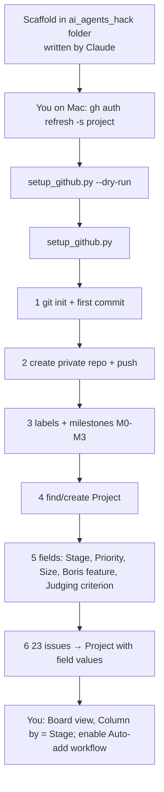
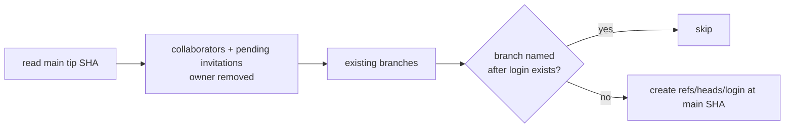

<!--
Author:    mikomeller
Version:   0.1.5
Filename:  todo.md
Pathname:  doc/tasks/todo.md
Purpose:   Plan and progress tracker for 12_family_shopper_agent (setup first, then the build backlog lives in the GitHub Project)
-->
# Plan — 12_family_shopper_agent

## Task 1 — Repo, GitHub Project and backlog (2026-11-27)

- [x] Research: Affinidi, TrustBoris brief, idealo MCP → `doc/research/affinidi_boris_idealo.md`
- [x] Diagrams: architecture + purchase sequence → `doc/diagrams/`
- [x] Scaffold: README, CLAUDE.md, .gitignore, issue forms, `config/family_budget.example.yaml`
- [x] Backlog: 10 labels, 4 milestones, 5 fields, 23 issues → `scripts/backlog.json`
- [x] Setup script `scripts/setup_github.py` (idempotent, `--dry-run`, `--project-number`)
- [x] Verified offline: script compiles; dry-run prints full plan (23 issue creates, 115 field edits); invalid label/field values are rejected; all YAML parses
- [x] Scaffold copied to the working folder `~/Documents/M1_20230921/src/genAI/12_family_shopper_agent` (17 files, checksums identical; Drive copy left untouched)
- [x] First live run failed at step 2 ("Unable to add remote origin"); fixed `ensure_repo` (v0.1.1): create repo without gh's remote handling, add origin only if missing, push when no upstream
- [x] Verified with real git against a local bare remote: push happens with existing origin; re-run skips the push
- [ ] **You:** re-run `python3 scripts/setup_github.py` on your Mac from that folder, then commit the script fix
- [ ] **You:** Board view (Column by = Stage) + Auto-add workflow
- [ ] Verify on GitHub: repo private, 23 issues in the Project, fields set, issue forms offered under "New issue"

## Task 2 — One branch per collaborator, main reserved for code (2026-11-27)

- [x] Script `scripts/create_collaborator_branches.py` (re-runnable, `--dry-run`)
- [x] Verified against a stubbed `gh`: owner skipped, existing branch skipped, pending invitee included, e-mail invite reported, zero writes to `main`
- [ ] **You:** after `setup_github.py` and inviting collaborators, run it on your Mac
- [ ] Verify on GitHub: one branch per collaborator, `main` unchanged
- [ ] Optional: protect `main` (require pull requests) — on a private personal repo this needs GitHub Pro

## Task 3 — Kanban hierarchy, orchestration, evals and handover (2026-11-27)

Diagram: [`doc/diagrams/orchestration.mmd`](../diagrams/orchestration.mmd)

- [x] Plan and recommendations presented; owner's go received (restructuring OK; orchestration runs in Claude Code)
- [x] Checked the docs: Claude Code subagent file format and `--agent`; GitHub sub-issues REST API
- [x] `scripts/backlog.json` v0.1.2: 7 epics, 10 new stories, 3 labels, `parent` on 30 stories (40 issues)
- [x] `scripts/setup_github.py` v0.1.2: step 7 links stories to epics; field values only on newly created issues
- [x] Verified with a stubbed `gh`: first run creates 17, reuses 23, links 30, 85 field edits (new issues only);
      re-run creates 0, links 0, 0 field edits; refused sub-issue API gives 30 warnings and the run still finishes
- [x] `scripts/board.py` v0.1.0 (list / move); verified against a stub: list, move, unknown stage, issue not on board
- [x] `doc/agents/` (source, to be copied to `.claude/agents/`; the desktop app may not write into `.claude`): orchestrator (system prompt), architect + reviewer (Opus), wallet-dev + test-eval + docs-demo (Sonnet)
- [x] `doc/evals/eval_plan.md` (L0–L4, 13 + 9 + 10 cases, scenario format)
- [x] `doc/handover/HANDOVER.md`, `doc/tasks/pending.md`
- [ ] **You:** run `python3 scripts/setup_github.py` on your Mac; check the epic links and `board.py list` against the real board
- [ ] **You:** `mkdir -p .claude/agents && cp doc/agents/*.md .claude/agents/`, then `claude --agent orchestrator` — confirm it starts and lists the five subagents
- [ ] **You:** decide A1 and A2 in `doc/evals/eval_plan.md`

## Open decisions
- Does a parent-approved child order still count against the child's personal cap? Proposal: yes.
- Does Boris forward the verified caller identity to MCP tools? → spike issue (P0, M0).

## Results
- 2026-11-27: scaffold and script delivered and verified offline; live GitHub run pending (needs mikomeller's gh login).
- 2026-11-27: collaborator-branch script delivered and verified with a stubbed gh; live run pending.
- 2026-11-27: Kanban hierarchy, orchestrator + subagents, eval plan, handover and pending list delivered; verified offline and against a stubbed gh. Live GitHub run and first Claude Code session pending. No product code yet.
